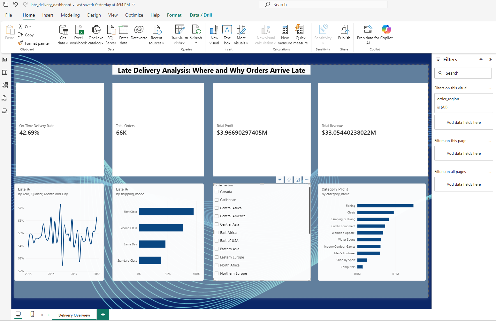

# Supply Chain Delivery Performance Analysis

SQL analysis of ~180,000 order lines from the DataCo Smart Supply Chain dataset,
answering where and why deliveries arrive late, and what it costs.

**Tools:** Python, DuckDB (SQL), Power BI

## Business questions
1. What share of orders arrive late, and is it improving over time?
2. Which shipping modes and regions have the most late deliveries?
3. Do late 
- Late orders cost **profit margin (-0.5pp), not revenue** (-0.7%, noise-level).
- **8 of 50 product categories drive ~85% of total profit**; no category loses money overall, but 15-24% of order lines in *every* category sell at a loss.deliveries reduce revenue or profit?
4. Which product categories drive profit, and which lose money?

## Key findings
- **54.8% of orders arrive late**, unchanged for 3 years (52–57% every month since Jan 2015).
- **100% of First Class orders are late**: promised in 1 day, always delivered in exactly 2. Fixing that promise alone would cut the late rate from 57% to ~42%.
- **Lateness does not measurably reduce revenue or profit** in this data: order value is fixed before shipping. The real cost is likely lost repeat customers.
- **8 of 50 product categories drive 85% of profit**; ~1 in 5 order lines sells at a loss, regardless of discount level.

Full analysis and recommendations: [FINDINGS.md](FINDINGS.md)



## How to run
1. Download the dataset from Kaggle ("DataCo Smart Supply Chain for Big Data Analysis")
   and put `DataCoSupplyChainDataset.csv` in `data/`.
2. Install dependencies: `pip install -r requirements.txt`
3. Load the data: `python load_data.py data/DataCoSupplyChainDataset.csv`
4. Run a query: `python run_sql.py sql/02_late_delivery_trend.sql`
   (results are saved to `output/` as CSV)
5. Open `dashboard/late_delivery_dashboard.pbix` in Power BI Desktop to explore the interactive dashboard.

## Project structure
```
load_data.py      cleans the CSV and loads it into DuckDB
run_sql.py        runs a .sql file and saves the result
sql/              01-05: one file per business question
                   06-07: granular exports that feed the Power BI dashboard
output/           query results (CSV), used by the dashboard
dashboard/        Power BI file (late_delivery_dashboard.pbix)
FINDINGS.md       findings and recommendations write-up
```
